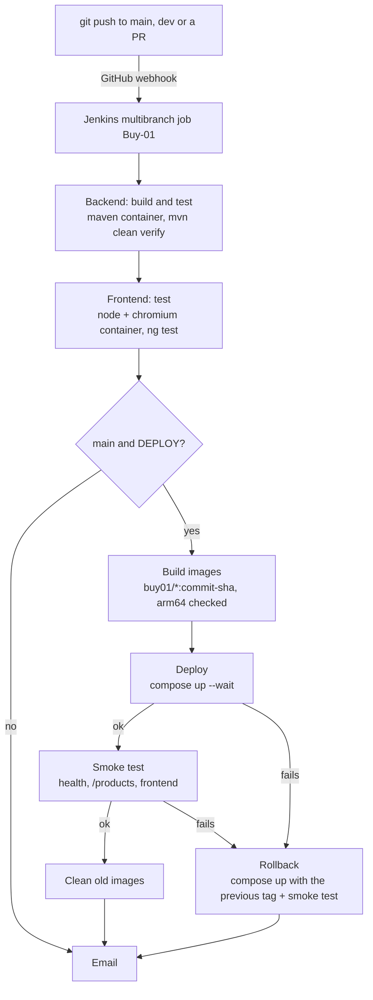

# CI/CD pipeline (mr-jenk)

The pipeline is the `Jenkinsfile` at the repo root. Jenkins itself is described in `infra/README.md`.

## Stages

- A failing test makes `mvn` or `ng test` exit non-zero, the stage fails and later stages are skipped. JUnit reports are published either way, so the failing test is visible in the Tests tab.
- The rollback target is read from the running `api-gateway` container before the deploy: whatever was live is what comes back. Images of the last 3 tags stay on disk for this.
- The build result stays FAILURE after a successful rollback: the commit did not make it to production, and the email says the previous tag is live again.

## Parameters

| Parameter | Default | Use |
|---|---|---|
| `DEPLOY` | true | Untick to build and test `main` without touching the live site |
| `SIMULATE_SMOKE_FAILURE` | false | Forces the smoke test to fail, to show the rollback during the audit |

An `ENVIRONMENT` choice is not offered: there is one VM, so there is one target. It becomes meaningful when the CI VM exists.

## Audit mapping

| Audit question | Where it is answered |
|---|---|
| Pipeline runs from start to finish | All stages above, Stage View of a `main` build |
| Jenkins responds to build errors | Failing stage stops the build, email with the log attached |
| Tests run automatically, halt on failure | Backend and Frontend stages, JUnit publishing |
| Commit and push trigger the pipeline | Webhook to `/github-webhook/`, signed with a shared secret |
| Automatic deploy and rollback strategy | Build images, Deploy, Smoke test, Rollback stages |
| Permissions on the dashboard | Matrix authorization: admin only, anonymous has nothing (JCasC) |
| Sensitive data | Jenkins credentials created by JCasC from a gitignored `.env`, used by id only |
| Jenkinsfile organization | Declarative stages, logic in small scripts under `scripts/ci/` |
| Test reports stored | JUnit results kept with each build (last 20 builds) |
| Notifications | Email on every build: result, commit, test counts, deployment and rollback outcome |
| Bonus: parameterized builds | `DEPLOY`, `SIMULATE_SMOKE_FAILURE` |
| Bonus: distributed builds | Controller with 0 executors, builds on the SSH agent, each stage in its own container |
