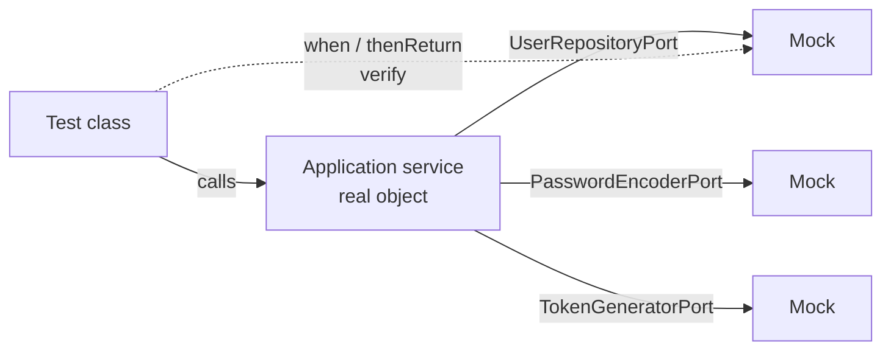

# Backend testing

## What we test and how

Unit tests check the business rules of each service's **application layer** (`application/service`), with no Spring context and no infrastructure. The class under test is real; everything it talks to through a port is replaced by a Mockito mock.



This works because of the hexagonal layout: a service only knows its ports (interfaces), so a test can plug in fakes instead of Mongo, Kafka or another service. The test decides what each port answers, then checks what the service returned, threw, or asked its ports to do.

Rules:
- Test business rules (each `if`, each `throw`, the happy path). Not getters, setters, or Spring wiring.
- One behavior per test, and the name says the rule: `register_fails_when_email_already_used`.
- No `@SpringBootTest`, no Testcontainers, no live Mongo, Kafka, Eureka, or JWT keys.
- A test must be able to fail. After it passes, break the rule in the service on purpose, check the test goes red, then undo.

The goal: `./mvnw -B clean verify` passes on a machine with nothing but Java 21, which is what the Jenkins pipeline runs (Phase 1). A failing test stops the pipeline.

## Where tests live

A test mirrors the package of the class it tests, under `src/test/java`:

| Class under test | Test class |
|---|---|
| `user-service/src/main/java/com/buy01/user/application/service/AuthServiceImpl.java` | `user-service/src/test/java/com/buy01/user/application/service/AuthServiceImplTest.java` |

Current suites:

| Module | Test classes | Notes |
|---|---|---|
| common-security | `JwtVerifierTest`, `JwtAuthenticationFilterTest`, `ReactiveJwtAuthenticationFilterTest`, `CommonSecurityAutoConfigurationTest` | 17 tests |
| user-service | `AuthServiceImplTest` | more coming (`UserServiceImpl`, `AvatarServiceImpl`) |
| product-service, media-service | planned | reactive services are tested with `StepVerifier` (reactor-test) |
| every service | `*ApplicationTests` (`contextLoads`) | needs live infra and JWT keys, so it fails on a clean machine. Being replaced by the unit tests above |

## Running the tests

### 1. Java 21

Maven runs through the wrapper (`backend/mvnw`), so only a JDK 21 is needed. The parent POM refuses anything older.

```bash
java -version                                  # must say 21
# no java on the PATH? Install one:
sudo apt install openjdk-21-jdk
# or use the JDK shipped with the VS Code Java extension:
export JAVA_HOME=~/.vscode/extensions/redhat.java-1.53.0-linux-x64/jre/21.0.10-linux-x86_64
```

### 2. Commands (from `backend/`)

| Goal | Command |
|---|---|
| One test class | `./mvnw -B -pl user-service -am test -Dtest=AuthServiceImplTest -Dsurefire.failIfNoSpecifiedTests=false` |
| One test method | `./mvnw -B -pl user-service -am test -Dtest='AuthServiceImplTest#login_returns_token_for_valid_credentials' -Dsurefire.failIfNoSpecifiedTests=false` |
| All tests of one service | `./mvnw -B -pl user-service -am test` |
| Everything, as CI does | `./mvnw -B clean verify` |

What the flags mean:
- `-pl user-service`: only this module.
- `-am` ("also make"): also build the modules it depends on, such as `common-security`.
- `-Dtest=...`: only this class, or `Class#method` for one method.
- `-Dsurefire.failIfNoSpecifiedTests=false`: do not fail on the dependency modules, which have no class with that name.
- `-B`: batch mode, plain output without colors or progress bars.

### 3. From VS Code

Open the test file and click the green run icon next to the class or a method, or use the Testing panel. If imports show in red, the Java extension has not loaded the multi-module project yet: run "Java: Clean Java Language Server Workspace" from the command palette, then reload.

## Reading the result

```
Tests run: 3, Failures: 0, Errors: 0, Skipped: 0 -- in com.buy01.user.application.service.AuthServiceImplTest
BUILD SUCCESS
```

| Field | Meaning |
|---|---|
| Failures | an assertion did not hold. Maven prints `expected: <...> but was: <...>` and the line |
| Errors | the test threw an exception it did not expect (often a missing stub returning `null`) |
| Skipped | disabled tests |

The full report of each class is in `<module>/target/surefire-reports/<TestClass>.txt`.

## Writing a test, step by step

Example: `AuthServiceImplTest`.

**1. Create the class** next to the service's package, with the Mockito extension. No Spring annotation.

```java
@ExtendWith(MockitoExtension.class)
class AuthServiceImplTest {
```

`MockitoExtension` creates the mocks before each test and fails a test that has a stub it never used.

**2. Declare one `@Mock` per port the constructor takes, and the class under test with `@InjectMocks`.**

```java
    @Mock
    private UserRepositoryPort userRepository;
    @Mock
    private PasswordEncoderPort passwordEncoder;
    @Mock
    private TokenGeneratorPort tokenGenerator;

    @InjectMocks
    private AuthServiceImpl authService;
```

A mock answers every call with an empty default (`false`, `null`, `Optional.empty()`) until told otherwise. `@InjectMocks` calls the real constructor with the mocks.

**3. Write each test in three parts: arrange, act, assert.**

```java
    @Test
    void register_fails_when_email_already_used() {
        // arrange: describe the situation through the ports
        CreateUserCommand command = new CreateUserCommand("Hamza", "taken@buy01.test", "secret123", Role.CLIENT, null);
        when(userRepository.existsByEmail("taken@buy01.test")).thenReturn(true);

        // act + assert: the rule is "registration is refused"
        assertThrows(UserAlreadyExistsException.class, () -> authService.register(command));

        // assert the side effect that must NOT happen
        verify(userRepository, never()).save(any());
    }
```

**4. Pick the right check for the rule.**

| The rule is about | Use |
|---|---|
| a returned value | `assertEquals(expected, actual)` |
| an error | `assertThrows(SomeException.class, () -> service.call(...))` |
| a call that must happen | `verify(port).method(args)` |
| a call that must not happen | `verify(port, never()).method(any())` |
| an object the service built and passed to a port | `ArgumentCaptor` + `verify(port).method(captor.capture())`, then inspect `captor.getValue()` |

Example with a captor, to check the stored password is encoded:

```java
        ArgumentCaptor<User> savedUser = ArgumentCaptor.forClass(User.class);
        verify(userRepository).save(savedUser.capture());
        assertEquals("encoded-secret", savedUser.getValue().getPassword());
```

**5. Stub exact arguments.** `when(passwordEncoder.matches("secret123", "encoded-secret"))` only answers `true` for those values. If the service passes the wrong value, the mock returns its default and the test fails, so the arguments are part of what is tested.

**6. Run the class, then prove it can fail** (break the rule in the service, see red, undo).

## Troubleshooting

| Symptom | Cause and fix |
|---|---|
| `No tests matching pattern ... were executed` | `-Dtest` used with `-am` without `-Dsurefire.failIfNoSpecifiedTests=false` |
| `UnnecessaryStubbingException` | a `when(...)` the test never used. Remove it, or the service did not take the path you expected |
| `NullPointerException` inside the service | a port method was not stubbed and returned `null`. Add the `when(...)` for that call |
| `*ApplicationTests` fails with `security.jwt.public-key is not a valid base64` | the old `contextLoads` test needs real JWT keys. Expected until it is removed |
| `The JAVA_HOME environment variable is not defined correctly` | set `JAVA_HOME` (step 1) |
