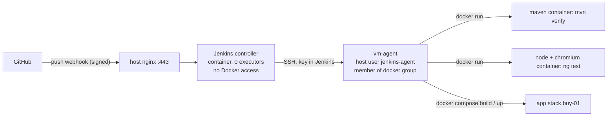

# CI infrastructure

Jenkins for the Buy-01 pipeline. Phase 1 runs it on the app VM (decision of 2026-11-12, see `docs/zone01/decisions.md`). In Phase 2 the controller moves to the CI VM with SonarQube and Nexus; the agent stays on the app VM, so only the agent `host` in `casc/jenkins.yaml` changes.

| Path | What |
|---|---|
| `docker-compose.yml` | The Jenkins controller, bound to `127.0.0.1:8090` |
| `jenkins/Dockerfile`, `jenkins/plugins.txt` | Controller image: pinned LTS on JDK 21 plus plugins |
| `jenkins/casc/jenkins.yaml` | Every setting: security, agent, credentials, email, the job |
| `jenkins/agents/node/Dockerfile` | Container for the frontend tests (Node 22 and Chromium, ARM64) |
| `proxy/jenkins.conf` | Host nginx site for `https://jenkins.buy-01.duckdns.org` |
| `../Jenkinsfile` | The pipeline. Flow and audit mapping in `docs/ci-pipeline.md` |
| `../scripts/ci/` | Build images, deploy, smoke test, rollback target, image cleanup |

## How it fits together



## Why an SSH agent and not the Docker socket

The pipeline needs Docker to run build containers and to deploy. Three options:

1. Mount `/var/run/docker.sock` into the controller. Anyone who gets into Jenkins (a vulnerable plugin, a stolen admin session) is root on the VM. Rejected.
2. A Docker socket proxy in front of the socket. To build images and start containers, the proxy must allow `POST /containers/create`, and that call can mount `/` of the host into a container. So it is still root on the VM, only less visible. Rejected: it looks safer than it is.
3. **Chosen:** the controller has no Docker at all. It starts an SSH agent on the VM host as a dedicated user, `jenkins-agent`, and only that user is in the docker group. The web-facing part (controller, plugins, UI) cannot reach Docker. The agent accepts only the controller's key, and only from the Docker network (`from=` in `authorized_keys`). Builds still have Docker, so the agent user is root-equivalent: what limits the risk is that only the admin can change jobs, and only `main`, `dev` and pull requests are built.

It also covers the "distributed builds" bonus: the controller schedules, the agent builds. Stronger option for later, not needed for the audit: rootless Docker for the agent user.

## Secrets

| Secret | Where it lives | How Jenkins gets it |
|---|---|---|
| Admin password, GitHub token, webhook secret, SMTP password | `infra/.env` (gitignored, `chmod 600`) | environment of the container, read by JCasC |
| Agent SSH private key | `/var/jenkins_home/casc-secrets/agent_ed25519`, generated inside the Jenkins volume, never leaves it | `${readFile:...}` in JCasC |
| App `.env` (JWT keys, Mongo passwords) | `/var/jenkins_home/casc-secrets/app.env`, copied from `~/buy-01/.env` | secret file credential `buy01-app-env` |

The Jenkinsfile only names credential ids. Jenkins masks their values in the console log. Credentials added by hand in the UI are deleted at the next restart: add them to `casc/jenkins.yaml`. Enterprise option, not needed here: Docker secrets or a vault instead of environment variables.

## Setup on the VM, in order

Run on the VM as `ubuntu`, in `~/buy-01` on this branch (or on `dev` once merged). About 45 minutes.

### 1. Agent user on the host

```bash
sudo apt-get update && sudo apt-get install -y openjdk-21-jre-headless
sudo useradd --create-home --shell /bin/bash jenkins-agent
sudo usermod -aG docker jenkins-agent
sudo -u jenkins-agent mkdir -p /home/jenkins-agent/agent /home/jenkins-agent/.m2 /home/jenkins-agent/.npm /home/jenkins-agent/.ssh
sudo chmod 700 /home/jenkins-agent/.ssh
```

The user has no password and no sudo. It only logs in with the controller's key.

### 2. Stop Jenkins and build the new image

```bash
cd ~/buy-01/infra
docker compose down          # never add -v: the volume holds the Jenkins home
docker compose build
```

### 3. Agent key, generated inside the Jenkins volume

```bash
docker compose run --rm --no-deps --entrypoint sh jenkins -c \
  'mkdir -p /var/jenkins_home/casc-secrets && chmod 700 /var/jenkins_home/casc-secrets &&
   ssh-keygen -t ed25519 -N "" -C jenkins-controller -f /var/jenkins_home/casc-secrets/agent_ed25519 &&
   cat /var/jenkins_home/casc-secrets/agent_ed25519.pub'
```

Copy the printed `ssh-ed25519 ...` line, then allow it on the host, only from Docker networks:

```bash
echo 'from="172.16.0.0/12" ssh-ed25519 AAAA...paste... jenkins-controller' \
  | sudo -u jenkins-agent tee /home/jenkins-agent/.ssh/authorized_keys
sudo chmod 600 /home/jenkins-agent/.ssh/authorized_keys
```

Record the host key so the controller can verify it is talking to this VM:

```bash
docker compose run --rm --no-deps --entrypoint sh jenkins -c \
  'mkdir -p ~/.ssh && ssh-keyscan -t ed25519 host.docker.internal > ~/.ssh/known_hosts && cat ~/.ssh/known_hosts'
```

### 4. App secrets for builds and deploys

```bash
{ cat ~/buy-01/.env; echo "UPLOADS_DIR=$HOME/buy-01/uploads"; } \
  | docker compose run --rm -T --no-deps --entrypoint sh jenkins -c \
    'umask 077 && cat > /var/jenkins_home/casc-secrets/app.env'
```

`UPLOADS_DIR` makes the deploy, which runs from the Jenkins workspace, use the existing upload folder. Repeat this step and restart Jenkins whenever `~/buy-01/.env` changes.

### 5. GitHub token

GitHub > Settings > Developer settings > Fine-grained tokens > Generate new token:

- Resource owner: `hmaach`. Repository access: Only select repositories > `Buy-01`.
- Repository permissions: Contents Read-only, Pull requests Read-only, Commit statuses Read and write (Jenkins shows the build result on each commit). Metadata Read-only is added automatically. Nothing else.
- Expiration: after your audit date (for example 2027-02-28). Note the date in your calendar.

### 6. Email

With Gmail: turn on 2-Step Verification, then create an app password at https://myaccount.google.com/apppasswords. Use the address as `SMTP_USER` and the 16 characters as `SMTP_PASSWORD`. Slack would need one more plugin and a bot token; email covers the audit.

### 7. Fill `infra/.env` and start

```bash
cp .env.example .env && chmod 600 .env
openssl rand -base64 24 | tr -d '/+='     # JENKINS_ADMIN_PASSWORD
openssl rand -hex 32                      # GITHUB_WEBHOOK_SECRET, keep it for step 9
nano .env
docker compose up -d --wait
docker compose logs jenkins | grep -iE 'casc|error' | tail -20
```

Use your existing admin username as `JENKINS_ADMIN_ID`: JCasC resets its password to `JENKINS_ADMIN_PASSWORD` at every start. If startup fails, the JCasC error in the log names the key it could not apply.

### 8. Check that it comes back the same

Log in at https://jenkins.buy-01.duckdns.org and check: Manage Jenkins > Nodes shows `vm-agent` online; Security shows the matrix with only your user; Credentials lists the five ids; the job `Buy-01` exists and has scanned `main` and `dev`. Then prove it is rebuilt from git:

```bash
docker compose down && docker compose up -d --build --wait
```

Everything above must be identical. This is the answer to "how would you rebuild this?": the image, the plugins and every setting come from `infra/`, only secrets come from `infra/.env` and the volume.

### 9. GitHub webhook

Repository > Settings > Webhooks > Add webhook:

- Payload URL: `https://jenkins.buy-01.duckdns.org/github-webhook/`
- Content type: `application/json`
- Secret: the `GITHUB_WEBHOOK_SECRET` value
- Events: "Let me select individual events" > Pushes and Pull requests

Save, then check Recent Deliveries shows a green 200 for the ping.

### 10. First deploy and rollback demo

1. Push a small commit to `main` (or merge `dev` into it). The build starts within seconds, deploys, and you get an email. This first deploy has no rollback target: the running containers were not built by the pipeline.
2. In Jenkins: Buy-01 > main > Build with Parameters > tick `SIMULATE_SMOKE_FAILURE`. The new tag is deployed, the smoke test fails, the Rollback stage redeploys the previous tag, and the email says "Rollback done".

### 11. Freeze plugin versions (once everything works)

```bash
docker compose exec jenkins sh -c 'for f in /var/jenkins_home/plugins/*.jpi; do
  v=$(unzip -p "$f" META-INF/MANIFEST.MF | grep "^Plugin-Version:" | cut -d" " -f2 | tr -d "\r")
  echo "$(basename "$f" .jpi):$v"; done' > jenkins/plugins.txt
```

Commit the result: the next image build installs exactly these versions.

## Reverse proxy

`proxy/jenkins.conf` is the host nginx site. Compare it with the live file before replacing it:

```bash
sudo diff /etc/nginx/sites-available/jenkins ~/buy-01/infra/proxy/jenkins.conf
sudo cp ~/buy-01/infra/proxy/jenkins.conf /etc/nginx/sites-available/jenkins
sudo nginx -t && sudo systemctl reload nginx
```

## Manual rollback

If Jenkins itself is down, any earlier tag can be started by hand on the VM:

```bash
cd ~/buy-01
docker images buy01/api-gateway          # list the tags still on disk
IMAGE_TAG=<tag> docker compose up -d --no-build --wait
```
